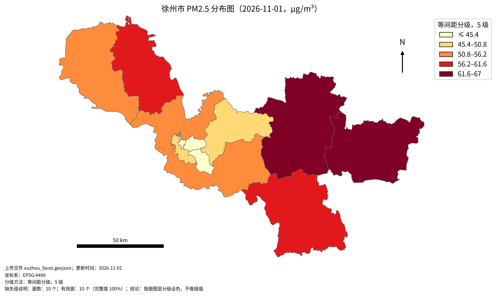
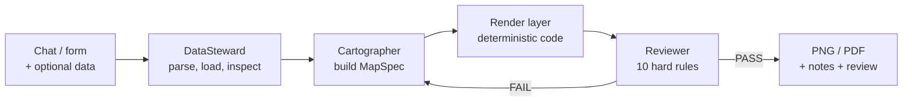

# Map Smith

> Describe a map in one sentence. Get a publication-ready thematic map.

[](https://github.com/dlg591103-cpu/Map-Smith/releases/latest)
[](https://www.python.org/)
[](docker-compose.yml)
[](docs/)

English | [简体中文](README.md)

Map Smith is a **natural-language thematic mapping agent**. Give it one sentence — or upload a point/statistical dataset — and it produces a finished thematic map (PNG / PDF) ready for reports and papers, together with mapping notes and a compliance review.

It is built for **people who need a map but do not know GIS**: journalists, teachers, local government staff, planning-office newcomers and students. The point is not merely to "draw a map", but to **produce a map that follows cartographic conventions**: title, legend, scale bar, north arrow, data source, projection and classification are completed according to explicit rules and then reviewed.



*Example output: PM2.5 distribution in Xuzhou (2026-11-01), actually generated by Map Smith's choropleth pipeline.*

## Contents

- [Why Map Smith](#why-map-smith)
- [Features](#features)
- [Quick Start](#quick-start)
- [Usage](#usage)
- [Workflow](#workflow)
- [Architecture](#architecture)
- [Data and Offline Fallback](#data-and-offline-fallback)
- [Scope and Boundaries](#scope-and-boundaries)
- [Project Layout](#project-layout)
- [Development and Tests](#development-and-tests)

## Why Map Smith

The "last mile" of GIS: far more people need a map than know how to use GIS. Today there are usually only two options — learn ArcGIS (expensive, hard, often impossible to install), or pay someone to make the map (tens to hundreds of yuan, plus waiting).

Map Smith offers a third path: describe the request in plain language and get a fully annotated, source-traceable, rule-reviewed thematic map in minutes.

## Features

| Feature | Description |
| --- | --- |
| One-sentence mapping | Provide region, time and indicator; the agent asks up to 2 clarifying questions instead of guessing defaults |
| Five map types | Choropleth, point / bubble, buffer analysis, overlay / clip, and IDW interpolation surface |
| Cartographic compliance | Title, classified legend with units, scale bar, north arrow, data source and update time, CRS, classification method, missing-data notes |
| Automated review | A reviewer agent applies 10 deterministic rules (PASS / FAIL) and triggers at most 2 rework rounds |
| Explainable and editable | Every decision is captured in a `MapSpec` JSON document; change one field and re-render in seconds |
| Offline ready | Bundled Xuzhou demo dataset; no online basemap service required |
| Multiple inputs | CSV, GeoJSON, Shapefile (zip), GeoTIFF basemap; CRS is validated and explicitly confirmed |

## Quick Start

Requires **Python 3.12+**. Choose one of three ways.

### Option 1: Download and run (recommended)

1. Open [Releases](https://github.com/dlg591103-cpu/Map-Smith/releases/latest) and download the latest `mapsmith-v0.1.1.zip`.
2. Extract it anywhere.
3. Start from the extracted root:
   - Windows PowerShell: `.\run.ps1`
   - macOS / Linux: `./run.sh`
4. Open <http://127.0.0.1:8501> in your browser.

On first run the script creates `.venv` and installs dependencies from `src/requirements.lock` (a few minutes). If Windows execution policy blocks the script:

```powershell
powershell -ExecutionPolicy Bypass -File .\run.ps1
```

Custom host and port:

```powershell
.\run.ps1 -Port 9000 -BindHost 0.0.0.0   # Windows
./run.sh --port 9000 --host 0.0.0.0      # macOS / Linux
```

### Option 2: Docker

No Python installation needed:

```bash
docker compose up --build
```

Open <http://127.0.0.1:8501>. Outputs (PNG / PDF) are written to the host `out/` directory.

### Option 3: Run from source

```bash
git clone https://github.com/dlg591103-cpu/Map-Smith.git
cd Map-Smith
```

Then run `.\run.ps1` (Windows) or `./run.sh` (macOS / Linux), or start manually:

```powershell
python -m venv .venv
.\.venv\Scripts\python.exe -m pip install -r src\requirements.lock
$env:PYTHONPATH = "src"
.\.venv\Scripts\python.exe -m mapsmith --port 8501
```

```bash
python3 -m venv .venv
./.venv/bin/python -m pip install -r src/requirements.lock
PYTHONPATH=src ./.venv/bin/python -m mapsmith --port 8501
```

The built frontend (`web/dist/`) is committed, so Node is not required at runtime. Node is only needed when modifying the frontend (`npm install && npm run dev` inside `web/`).

### Configure an LLM (optional)

The default is a local [Ollama](https://ollama.com/) instance (`http://127.0.0.1:11434/v1`, model `qwen2.5:3b`). Pull the model before using the chat mode:

```bash
ollama pull qwen2.5:3b
```

Any OpenAI-compatible API also works. Create a `.env` file in the project root:

```dotenv
MAPSMITH_LLM_BASE_URL=https://your-provider.example/v1
MAPSMITH_LLM_API_KEY=your-api-key
MAPSMITH_LLM_MODEL=your-model-name
```

If no model is available, the UI shows a message and the form mode still works with the bundled offline data.

## Usage

### Chat mode

Describe the request in the chat box, for example:

```text
PM2.5 distribution map of Xuzhou on 2026-11-01
```

Map Smith parses region, time and indicator, then loads data, inspects it, renders the map and runs the review. Missing information triggers a question (at most 2), never a silent default. Keywords such as "buffer" or "overlay / clip" select the corresponding map type.

### Form mode

Choose region, time, indicator and map type, and upload data when needed — useful when precise control over inputs matters.

Upload formats:

| Type | Format | Notes |
| --- | --- | --- |
| Vector | Shapefile (`.shp` / `.shx` / `.dbf` / `.prj` in one zip), GeoJSON, CSV (UTF-8) | Upload the whole Shapefile, not just `.shp` |
| Raster | GeoTIFF | Display-only basemap; no raster analysis or reprojection |

If a file declares no CRS, the UI asks you to confirm instead of assuming WGS84.

### Outputs

Each run returns:

- The map: PNG / PDF
- Mapping notes: data source, update time, CRS, classification method, missing-data notes
- Review report: per-rule PASS / FAIL results and fix suggestions
- `MapSpec`: the complete decision record for this map

## Workflow



- Missing information is asked back, not guessed (max 2 questions).
- If data cannot support interpolation, the map degrades to points / bubbles with a written reason.
- Failed reviews trigger at most 2 rework rounds; after that the map is still delivered with the review report attached.
- Global timeout is 60 seconds; on timeout the current `MapSpec` is rendered and annotated with "review not completed (timeout)".

## Architecture
```
One sentence (+ optional data files)
        │
        ▼
① Orchestration: three-agent loop (dialogue / decisions / rework)
        │
        ▼
② Decision layer: MapSpec (JSON)
   map type / classification / palette / annotation / layout / sources
        │
        ▼
③ Render layer: deterministic code turns the spec into a map (no LLM)
        │
        ▼
PNG / PDF + mapping notes + review report
```

**The LLM only makes decisions — it never computes statistics or writes plotting code.** Classification runs in `mapclassify`, rendering in `matplotlib`; the LLM only chooses which method to use and why. This makes results explainable, incrementally editable and testable.

| Role | Responsibility |
| --- | --- |
| DataSteward | Parse intent, define data needs, load data, inspect quality and decide degradation |
| Cartographer | Produce the complete `MapSpec`: classification, palette, layout, annotation |
| Reviewer | Judge PASS / FAIL against the cartographic rules and suggest fixes; never edits data or draws |

Stack: Python 3.12 + geopandas / shapely / pyproj / mapclassify / matplotlib + FastAPI; frontend Vue 3 + Vite (build output committed).

## Data and Offline Fallback

| Data | Source | Notes |
| --- | --- | --- |
| Administrative boundaries | Alibaba DataV GeoAtlas | Free; GCJ-02 corrected to WGS84 on load |
| Air quality | quotsoft.net national station CSV | Includes coordinates, ready for interpolation |
| POI / road network | OSM Overpass API | Free, no key |
| Offline fallback | Bundled `src/mapsmith/demo_data/` (Xuzhou, 2026-11-01) | Works without network |
| User uploads | CSV / GeoJSON / Shapefile(zip), optional GeoTIFF basemap | See CRS rules in docs |

Online endpoints may be unreachable on restricted networks; the bundled data keeps the full workflow available. No online basemap service is used, so live demos do not depend on connectivity.

The default output CRS is **CGCS2000 (EPSG:4490)**; CGCS2000 3-degree Gauss-Krüger and WGS84 UTM (auto zone selection) and Web Mercator (display only) are also supported.

## Scope and Boundaries

Map Smith performs **general-purpose thematic mapping** and does not promise professional surveying accuracy.

Exactly five map types are supported, and the list is closed:

1. Choropleth
2. Point / bubble map (with station labels)
3. Buffer analysis map
4. Overlay / clip result map
5. IDW interpolation surface (only when station count and coverage pass the adaptive check)

Out of scope:

- Raster analysis (clip, stretch, resampling); raster is display-only basemap
- Publishing map services
- Data management platform
- Custom projection definitions or parameter tuning

Every map must state its data source and update time. Inputs may declare any CRS but require explicit confirmation; outputs are limited to a whitelist of projections.

## Project Layout

```text
.
├── src/mapsmith/          # Backend: agents / io / render / tools / kb / demo_data
├── src/tests/             # pytest suite
├── web/                   # Vue 3 + Vite frontend (built dist/ committed)
├── docs/                  # Product facts, SPECs, self-checks, acceptance records, rules
├── run.ps1 / run.sh       # One-click start (Windows / macOS / Linux)
├── Dockerfile             # Container image
├── docker-compose.yml     # Compose setup (port 8501)
├── package.py             # Build the release zip
└── README.md              # Chinese README
```

## Development and Tests

```bash
cd src
python -m pytest
```

Tests cover MapSpec validation, projection zone selection, data loading and uploads, classification and rendering, review rules, the three-agent loop and the FastAPI endpoints. Frontend development is documented in [`web/README.md`](web/README.md).

Build the release zip:

```bash
python package.py
```
