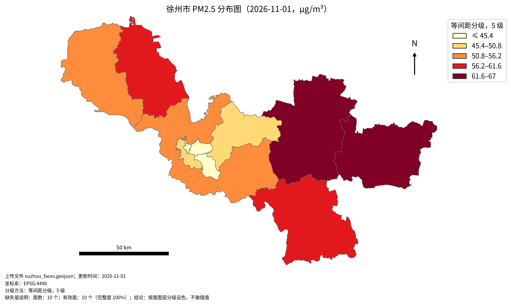
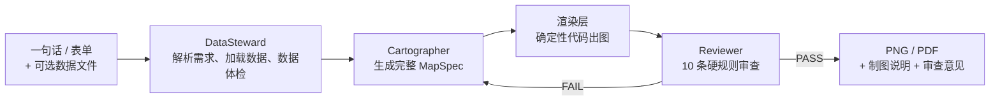

# Map Smith

> 说一句话，出一张符合制图规范的专题地图。

[](https://github.com/dlg591103-cpu/Map-Smith/releases/latest)  
[](https://www.python.org/)  
[](docker-compose.yml)  
[](docs/)

[English](README.en.md) | 简体中文

Map Smith 是一个**自然语言专题制图智能体**。输入一句话（或上传一份点位 / 统计数据），输出一张可直接进入报告和论文的成品专题图（PNG / PDF），并附制图说明与合规审查意见。

它面向**需要一张图但不会 GIS 的人**——记者、教师、基层业务人员、规划院新人、学生。核心差异不是「画一张图」，而是「按制图学规范出一张图」：图名、图例、比例尺、指北针、数据来源、投影与分级方法都会按规则补齐并接受审查。



*示例输出：徐州市 PM2.5 分布图（2026-11-01），由 Map Smith 的分级设色流程实际生成。*

## 目录

-   [为什么用它](#%E4%B8%BA%E4%BB%80%E4%B9%88%E7%94%A8%E5%AE%83)
-   [核心能力](#%E6%A0%B8%E5%BF%83%E8%83%BD%E5%8A%9B)
-   [快速开始](#%E5%BF%AB%E9%80%9F%E5%BC%80%E5%A7%8B)
-   [使用方法](#%E4%BD%BF%E7%94%A8%E6%96%B9%E6%B3%95)
-   [工作流程](#%E5%B7%A5%E4%BD%9C%E6%B5%81%E7%A8%8B)
-   [技术架构](#%E6%8A%80%E6%9C%AF%E6%9E%B6%E6%9E%84)
-   [数据与离线兜底](#%E6%95%B0%E6%8D%AE%E4%B8%8E%E7%A6%BB%E7%BA%BF%E5%85%9C%E5%BA%95)
-   [适用范围与边界](#%E9%80%82%E7%94%A8%E8%8C%83%E5%9B%B4%E4%B8%8E%E8%BE%B9%E7%95%8C)
-   [项目结构](#%E9%A1%B9%E7%9B%AE%E7%BB%93%E6%9E%84)
-   [开发与测试](#%E5%BC%80%E5%8F%91%E4%B8%8E%E6%B5%8B%E8%AF%95)

## 为什么用它

GIS 的「最后一公里」：需要一张图的人，远多于会用 GIS 的人。现状通常只有两条路——学 ArcGIS（贵、难、装不上），或找人代做（几十到几百元、要等）。

Map Smith 提供第三条路：用日常语言描述需求，几分钟内拿到一张要素齐全、来源可追溯、经过规则审查的专题图。

## 核心能力

| 能力 | 说明 |
| --- | --- |
| 一句话出图 | 说出区域、时间、指标即可出图；信息不足时反问，一次最多 2 个问题，不猜默认值 |
| 多轮补齐 | 分几轮补充信息也能记住前面说过的内容，不会反复追问同一个字段 |
| 五类专题图 | 分级设色图、点图 / 气泡图、缓冲区分析图、空间叠加 / 裁剪图、IDW 空间插值面 |
| 社会经济统计 | 接聚汇数据开放 API（243 个榜单）：GDP、人均 GDP、人口、财政收入、城镇化率、CPI 等，任意省 / 地级市直接出图；也支持上传统计表（自动识别行政区名列并关联边界） |
| 空气质量 | quotsoft 全国 2127 个站点逐日数据；站点过密时自动降级为「区县聚合面域」 |
| 按规范出图 | 图名、图例分级与单位、比例尺、指北针、数据来源与更新时间、坐标系、分级方法、缺失值说明 |
| 合规审查 | 审图员按 10 条确定性硬规则判定 PASS / FAIL，不合格自动返工（最多 2 轮），不会无限循环 |
| 历史会话 | 对话按会话落盘到 `out/sessions/`，刷新页面、重启服务、换浏览器都能恢复；侧栏可切换与删除 |
| 可解释、可修改 | 所有决策沉淀为一份 `MapSpec` JSON；改一个字段即可重渲染，几秒出新图 |
| 离线可用 | 内置徐州多日空气质量、江苏各市 GDP、区县 PM2.5 等演示数据，断网也能演示；不依赖在线底图服务 |
| 多格式输入 | CSV、GeoJSON、Shapefile（zip）、GeoTIFF 底图；坐标系统一校验并要求显式确认 |

## 快速开始

运行需要 **Python 3.12+**。三种方式任选其一。

### 方式一：下载即用（推荐）

1.  打开 [Releases](https://github.com/dlg591103-cpu/Map-Smith/releases/latest)，下载最新的 `mapsmith-v0.2.0.zip`。
2.  解压到任意目录。
3.  启动：
    -   **Windows：双击 `start.cmd`**（推荐，自动找 Python、装依赖、开浏览器）
    -   macOS / Linux：`./run.sh`
    -   或手动用 `.\run.ps1`（Windows PowerShell）
4.  浏览器打开 [http://127.0.0.1:8501](http://127.0.0.1:8501)。
5.  点侧栏底部 **「⚙ 设置 API」** 填入自己的 Key（见[配置 API Key](#配置-api-key推荐在界面内完成)）。
    不填也能用：表单模式 + 内置离线数据可以直接出图。

**首次运行会自动创建 `.venv` 并安装约 60 个依赖，需要 2–5 分钟**（`start.cmd` 会走华为云镜像，失败自动回退官方源）。之后再启动只需几秒。

> **Windows 用户请优先用 `start.cmd`**：
> - `.cmd` 不受 PowerShell 执行策略限制，双击即可
> - 会自动在常见安装位置与 PATH 中查找 Python 3.12
> - 找不到时按提示装好 Python 并勾选「Add python.exe to PATH」

若坚持用 PowerShell，执行策略可能阻止 `.ps1`，改用：

```powershell
powershell -ExecutionPolicy Bypass -File .\run.ps1
```

自定义监听地址与端口：

```powershell
.\run.ps1 -Port 9000 -BindHost 0.0.0.0   # Windows
./run.sh --port 9000 --host 0.0.0.0      # macOS / Linux
```

### 方式二：Docker

不装 Python 也能运行：

```bash
docker compose up --build
```

浏览器打开 [http://127.0.0.1:8501](http://127.0.0.1:8501)。产物（PNG / PDF）会写入宿主机 `out/` 目录。
首次使用同样在侧栏 **「⚙ 设置 API」** 里填 Key（容器内写的是挂载的 `.env`）。

### 方式三：从源码运行

```bash
git clone https://github.com/dlg591103-cpu/Map-Smith.git
cd Map-Smith
```

然后直接执行 `.\run.ps1`（Windows）或 `./run.sh`（macOS / Linux），或手动启动：

```powershell
python -m venv .venv
.\.venv\Scripts\python.exe -m pip install -r src\requirements.lock
$env:PYTHONPATH = "src"
.\.venv\Scripts\python.exe -m mapsmith --port 8501
```

```bash
python3 -m venv .venv
./.venv/bin/python -m pip install -r src/requirements.lock
PYTHONPATH=src ./.venv/bin/python -m mapsmith --port 8501
```

前端构建产物 `web/dist/` 已入库，运行时不需要 Node。只有修改前端时才需要进入 `web/` 执行 `npm install && npm run dev`。

### 配置 API Key（推荐在界面内完成）

启动后浏览器打开 [http://127.0.0.1:8501](http://127.0.0.1:8501)，点侧栏底部的 **「⚙ 设置 API」**，
直接填写并保存即可生效——不用重启、不用手改文件。

需要两类 Key，按你要用的功能选填：

| 配置项 | 用途 | 不填的后果 |
| --- | --- | --- |
| **对话模型（LLM）** | 一句话生成地图 | 用不了对话模式，**但表单模式照常出图** |
| **统计数据（聚汇）** | GDP / 人口等社会经济指标 | 空气质量图照常，**统计类指标做不了** |

**两者都不填也能用**：表单模式 + 内置离线数据（徐州多日空气质量、江苏各市 GDP、
区县 PM2.5）可以完整出图。

#### 对话模型怎么填

两条路选一条：

**A. 本机 Ollama（免费、离线）**

1.  安装 [Ollama](https://ollama.com/)
2.  `ollama pull qwen2.5:3b`
3.  `ollama serve`
4.  设置窗口**保持默认**：地址 `http://127.0.0.1:11434/v1`、模型 `qwen2.5:3b`，
    密钥填任意非空值（如 `ollama`）

**B. 云端 API（DeepSeek / OpenAI / 任意 OpenAI 兼容服务）**

在设置窗口填三项，以 DeepSeek 为例：

| 字段 | 填什么 |
| --- | --- |
| API 地址 | `https://api.deepseek.com/v1` |
| 模型名 | `deepseek-chat` |
| 密钥 | 你自己的 key |

> ⚠️ **注意**：默认配置指向本机 Ollama。没装 Ollama 时界面仍显示「模型：已配置」
> （三项都有默认值），但发对话会提示「本地模型未启动」——这时按 B 填云端 API 即可。

#### 统计数据怎么填

1.  到 [聚汇数据](https://www.gotohui.com/member/api-keys) 注册并创建 API Key
2.  设置窗口粘贴保存

省级榜单免费；画到「市级下辖区县」按次消耗积分（1 积分买断一个指标 365 天）。

#### 也可以手改 `.env`（适合批量部署 / 容器）

在项目根目录创建 `.env`：

```
MAPSMITH_LLM_BASE_URL=https://your-provider.example/v1
MAPSMITH_LLM_API_KEY=your-api-key
MAPSMITH_LLM_MODEL=your-model-name
MAPSMITH_STATS_API_KEY=your-gotohui-key
```

界面内设置窗口保存时写的就是这个文件，两种方式等价。

未配置或模型不可用时，界面会给出中文提示，仍可用表单模式 + 内置离线数据出图。

## 使用方法

### 一句话模式

在对话框里描述需求，例如：

```text
徐州市 2026-11-01 的 PM2.5 分布图
```

系统会解析区域、时间与指标，完成数据加载、体检、出图和审查。缺少必要信息时会反问你（最多 2 个问题），不会擅自套用默认值。提到「缓冲」或「叠加 / 裁剪」时，会按关键词选择对应图种。

### 表单模式

在表单中选择区域、时间、指标、图种，并按需上传数据；适合需要精确控制输入的场景。

上传格式：

| 类型 | 格式 | 说明 |
| --- | --- | --- |
| 矢量 | Shapefile（`.shp` / `.shx` / `.dbf` / `.prj` 打成 zip）、GeoJSON、CSV（UTF-8） | Shapefile 必须整体上传，不能只传 `.shp` |
| 栅格 | GeoTIFF | 仅作离线底图显示，不做栅格分析与重投影 |

文件未声明坐标系时会弹窗要求确认，不会静默默认 WGS84。

### 输出

每次出图返回：

-   成品图：PNG / PDF
-   制图说明：数据来源、更新时间、坐标系、分级方法与缺失值说明
-   审查意见：10 条规则的逐条判定结果与修复建议
-   `MapSpec`：本次制图的完整决策记录

## 工作流程


-   信息不足时不猜默认值，先反问（最多 2 问）。
-   数据不满足插值条件时自动降级：站点数与覆盖率不足则降为点图 / 气泡图，并写明理由。
-   审查不合格最多返工 2 轮；仍不通过则照常出图并附审查意见，不抛错误页、不返回空白图。
-   全局最长 60 秒，超时用当前 `MapSpec` 出图，并在图上标注「审查未完成（超时）」。

## 技术架构
```
用户一句话（+ 可选数据文件）
        │
        ▼
① 编排层：三 Agent 循环（对话 / 决策 / 返工）
        │ 产物
        ▼
② 决策层：MapSpec（JSON）
   图种 / 分级方法 / 配色 / 注记 / 版式 / 数据源声明
        │
        ▼
③ 渲染层：确定性代码把 spec 变成图（不含任何 LLM）
        │
        ▼
PNG / PDF + 制图说明 + 审查意见
```

**LLM 只做决策，不做计算、不写绘图代码。** 分级由 `mapclassify` 计算，出图由 `matplotlib` 绘制，LLM 只负责「选哪种方法、为什么选」。这让结果可解释、可增量修改、可测试。

| 角色 | 职责 |
| --- | --- |
| DataSteward | 解析意图、生成数据需求、加载数据、数据体检与降级判定 |
| Cartographer | 依据数据与需求产出完整 `MapSpec`（分级、配色、版式、注记） |
| Reviewer | 按制图规范逐条判定 PASS / FAIL，给修复建议；不改数据、不代画 |

技术栈：Python 3.12 + geopandas / shapely / pyproj / mapclassify / matplotlib + FastAPI；前端 Vue 3 + Vite（构建产物入库）。

## 数据与离线兜底

| 数据 | 来源 | 备注 |
| --- | --- | --- |
| 行政边界 | 阿里 DataV GeoAtlas | 免费；GCJ-02 加载时纠偏到 WGS84 |
| 空气质量 | [quotsoft.net](http://quotsoft.net) 全国站点 CSV | 含经纬度，可直接做空间插值 |
| POI / 路网 | OSM Overpass API | 免费、无需 key |
| 离线兜底 | 内置 `src/mapsmith/demo_data/`（徐州，2026-11-01） | 断网也能演示 |
| 用户上传 | CSV / GeoJSON / Shapefile(zip)，可附加 GeoTIFF 底图 | 坐标系规则见文档 |

在线接口在受限网络下可能不可达；此时使用内置离线数据，功能与审查流程不受影响。不接入在线底图服务，避免现场演示依赖网络。

默认输出坐标系为 **CGCS2000（EPSG:4490）**；也支持 CGCS2000 3° 高斯-克吕格（自动选带）、WGS84 UTM（自动选带）与 Web Mercator（仅显示）。

## 适用范围与边界

Map Smith 做**通用专题制图**，不承诺专业测绘精度。

明确支持五种图种，且封顶不再扩展：

1.  分级设色图（choropleth）
2.  点图 / 气泡图（含站点标注）
3.  缓冲区分析图（buffer）
4.  空间叠加 / 裁剪结果图（overlay / clip）
5.  IDW 空间插值面（仅当站点数与覆盖率通过自适应判定时启用）

明确不做：

-   栅格分析（裁剪、拉伸、重采样等），仅支持栅格底图显示
-   地图服务发布
-   数据管理平台
-   自定义投影定义与参数微调

每张图强制标注数据来源与更新时间；输入可声明任意 CRS 并显式确认，输出限白名单投影。

## 项目结构

```text
.
├── src/mapsmith/          # 后端：agents / io / render / tools / kb / demo_data
├── src/tests/             # pytest 测试
├── web/                   # Vue 3 + Vite 前端源码（dist/ 为入库的构建产物）
├── docs/                  # 产品事实、SPEC、自检、验收、工程规则
├── run.ps1 / run.sh       # 一键启动（Windows / macOS / Linux）
├── Dockerfile             # 容器镜像
├── docker-compose.yml     # 容器编排（端口 8501）
├── package.py             # 生成发行 zip
└── README.en.md           # English README
```

## 开发与测试

```bash
cd src
python -m pytest
```

测试覆盖 MapSpec 校验、投影选带、数据解析与上传、分级与渲染、审图规则、三 Agent 编排、FastAPI 接口等。前端开发见 [`web/README.md`](web/README.md)。

打包发行 zip：

```bash
python package.py
```
